# COMP2030 Usability Evaluation, Iteration, and Demonstration

## Usability Testing Report
The test participants were recruited randomly from the university lecture aging aproximitely 20 on average, with one outlier being between 41-50

The test participants all spoke english as a first language, and the majorities education level was at an undergraduate level. Its to be noted that due to all the participants being from the same lecture room, they have similar levels of technological knowledge and a similar mental model.

The test participants were 75% male and 25% female

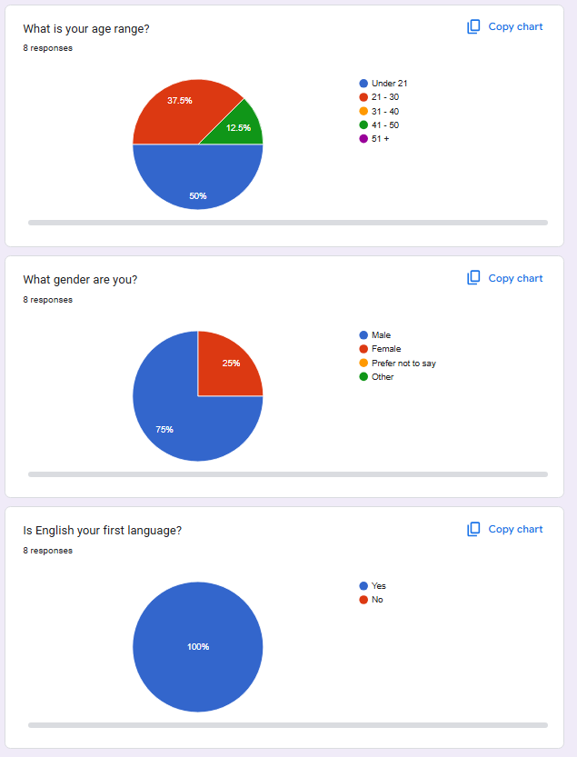

The list of specific tasks given to the participants were to register an account as a student with a username, email, password (larger than 8 characters), as well as confirming the password. After registering, the code would automatically login and bring them to the home page where they were specified to find their profile and adjust the user’s personal information. The information they changed was the name of the account, degree, university that they attended, which year they were in, and an example biography. This information was needed to be inputted as it was not required to create the account. From this page, they were instructed to create a request for help with the intention to find out if they used the button on the inbuilt tab on the left of the screen, or the “create request” button in the actual profile. After filling out a request, they were asked to try and accept another persons request and then send them a message. Lastly, they were asked to change their password in the settings menu. 

The testing followed think aloud questions, visual observations while overlooking the test as well as a system usability scale (SUS) 10 question.

The metrics we decided to follow to measure our success was a task completion rate of above 90% given no verbal or third party assistance, a SUS score of 70% or higher as well as good feedback outweighing the negative. 

---

## Testing Summary and Analysis

### Summary:

#### Task Completion and Overall Performance:
Participants exceeded our task completion threshold of 90% demonstrating exceptional usability and good intuitive design.

#### Registration:
Registration had some issues despite 100% completion, multiple participants (4 out of 8) struggled with password requirements, saying "the password did not say it was required to be 8 characters." Email validation also allowed entries without the "@" symbol.

#### Profile Editing:
Profile navigation and information editing was seamless for the users, however one user said they, "wanted to have my availability on the website”.

#### Settings and Interface:
Participants were able to locate and use the settings page flawlessly, but the language drop down caused confusion and frustration with one user noting “either delete the languages drop down menu or make it work!"

#### Requests and Messaging:
Creating requests was fully complete with users finding it "very intuitive and easy," although one participant was unsure "where to find the service request once it was lodged." There were some navigation challenges with the messaging as users noted needing to navigate to a person’s profile and then click “message” was not entirely intuitive.

#### Feature Suggestions:
Additional features requested included notifications, trust and reputation system, and discussion forum "like Reddit to get broader student feedback,".

#### Overall Impression:
Overall, participants excelled at utilizing the platform to complete tasks describing it as working "as you would think it would work" indicating successful mental model alignment.

### Analysis:
It is important to look at the demographic that was used for the usability testing survey as most participants were tech-savvy, uni students, aged around 20. This is also the target demographic for the website, which helps get an accurate reading for the website testing, enabling better suggestions and more impactful modifications to suit the target users. Many of the responses from the usability testing survey are listed into categories of 1 to 5 with some questions requiring written responses. This gives a lot of numerical data to analysis.

One of the participants entered 5 as every answer, when able. This gives some misleading results as they strongly agree with both positive and negative questions, contradicting themselves with many of their responses.

#### Profile Creation:
Users were asked to register and then login to their profile. The results for these questions are shown in Images 3 and 4 in the Appendix below. The data suggests that the participants found the processes easy but there could still be improvements as the scores contained a few threes and fours along with some comments of issues. 

#### Overall Ease of software use:
The responses display that the participants found the software to be easy to use and not complex. Results are shown in images 7-9. Most participants wouldn’t need additional support to use the software and would learn to use it very quickly.  The results also show that there is less agreement with the integration and consistency of the software as there are more values towards the higher-middle rather than towards one end of the graph.

---

## Iteration Description
Looking at some of the results in the survey that was done there are a few specific worded answers that relate to some issues with the website in terms of usability. These were consisted of, not explaining that the password needed to be a minimum of 8 letters long, allowing emails to be entered and parsed through without a @ symbol, not being able to find someone’s profile to message them from the message tab and not displaying availability on the profile for what times they can help.

#### Design, HTML, CSS
-	The login and sign-up pages had a short descriptive sentence added to explain what format the password should be in (minimum of 8 characters long). This helps with the frustration of entering a password to only then be told that it needs to be 8 characters long.
-	Images were added to all the tabs as well as some of the pages such as home and search. This helps with visual clarity allowing less stress on the eyes creating a more enjoyable time which can help boost the future lookbacks on the website.
-	On each of the descriptive features that can be changed, empty states and placeholders were added explaining what they are for and what to do with them. This helps with some confusion on how these descriptions affect their overall profile and requests.
-	A red circle was added to the messages word on the tab that displays the number of unread messages. This helps with clarity and sticks out being easy to see.

JavaScript
-	Email fields are stricter enforcing the email to be valid with a @ symbol. This helps with accidental inputs of emails as well as security being enforced ensuring it’s a valid email address.
-	Profile and Search tabs properly show each of their descriptions and will state whether the current person hasn’t updated a section or added anything. This reduces confusion as well as consistency across all skill requests.

PHP
-	Initailise JSON arrays like skills offered and skills requested with blank statements and will update when changed. This ensures that its consistent between every new profile.
-	Update number of messages haven’t been viewed when a message has been received and will reset to 0 when the Boolean has been switched by the messages being viewed. This helps with clarity of when a new message has come through.

MySQL
-	Added fields for message notifications such as a Boolean if messages have been viewed or not and another field for how many messages haven’t been viewed since last time. Makes it easier to access for later ensuring consistency and accuracy.

---

## Appendix:

## Script:
### Introduction
Thank you for participating in this usability test for **FUSS (Flinders University Skill Share)**.  
This test will take approximately **10–15 minutes**. We're testing the **website**, not you there are no wrong answers.  

Please **think aloud** as you complete tasks, saying whatever is on your mind whether it’s thoughts, confusion, or frustrations.  
Your honest feedback will really help us improve the platform.

### Tasks

#### Task 1: Register
"First step is to create an account. You can use any username, email, and password you'd like nothing needs to be real."

#### Task 2: Find Your Profile
"Great. Now find and go to your profile page."

#### Task 3: Fill Out Profile
Complete your profile. Add:
- Your name  
- Your degree  
- University  
- What year you're in  
- A brief bio  

"Just add whatever"

#### Task 4: Create a Request
Now imagine that you need help with some Python assignment. Write a request for coding help.

#### Task 5: Accept a Request
"Now turn the tables — assume someone needs your help. Locate and accept a service request from a fellow student."

#### Task 6: Send a Message
"You've accepted the request. Now send that person a message to coordinate meeting up."

#### Task 7: Change Password
"Go to settings and change your password."

### Survey Results:
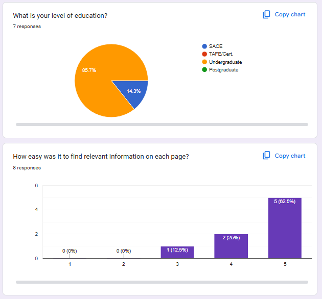

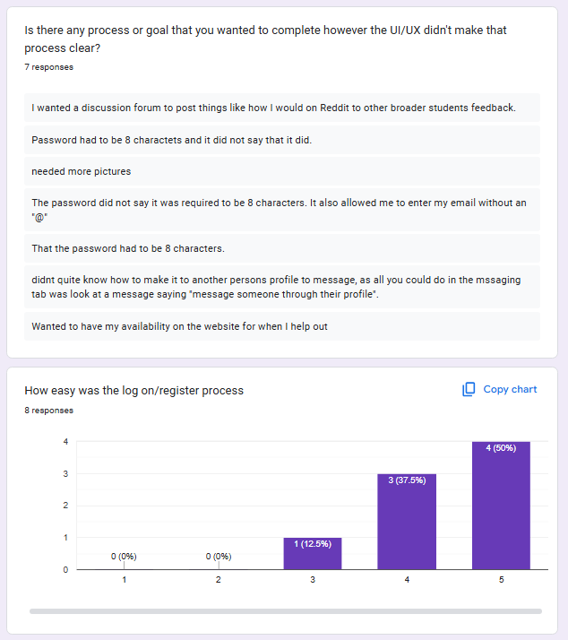
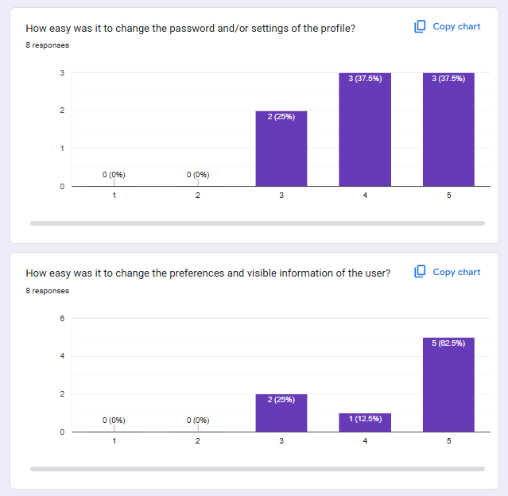
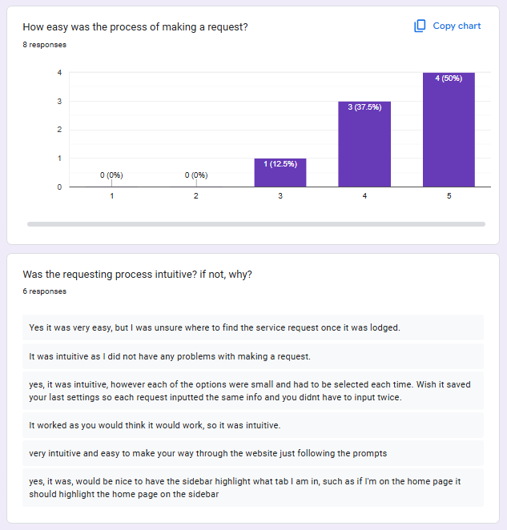
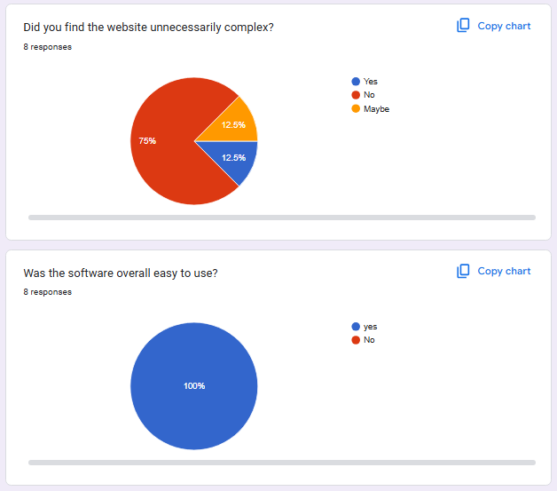
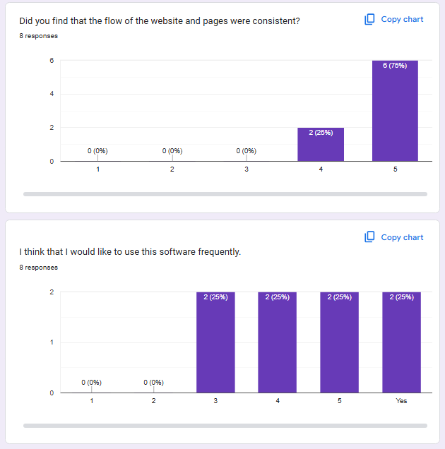
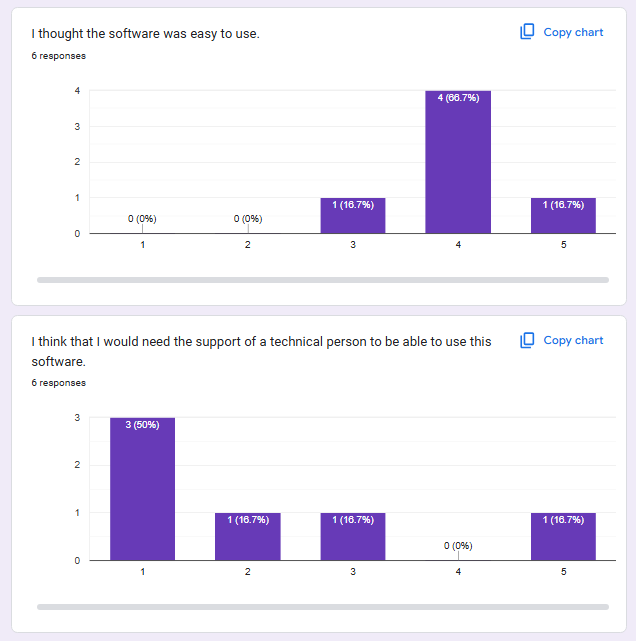
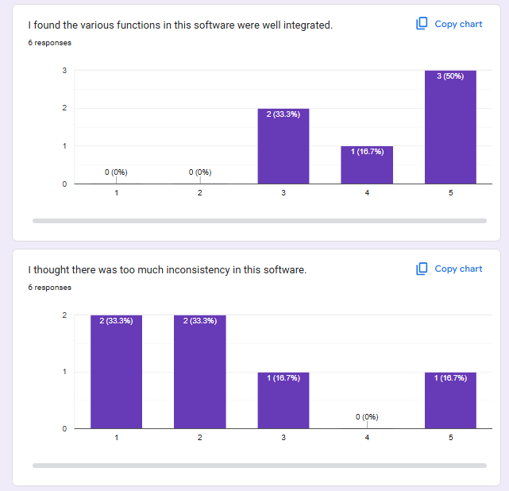
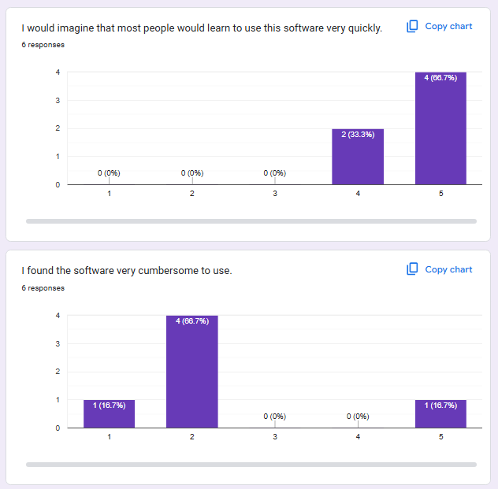
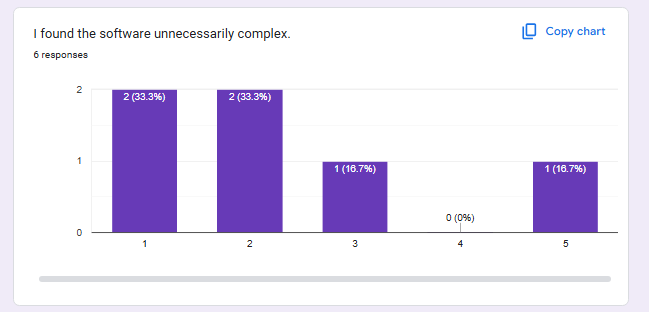
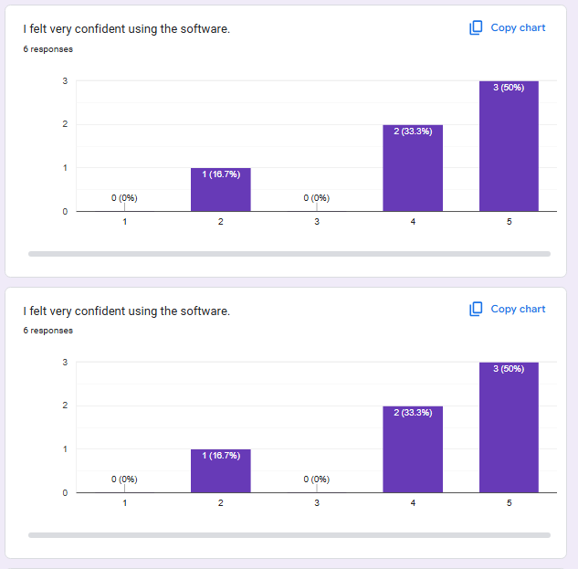
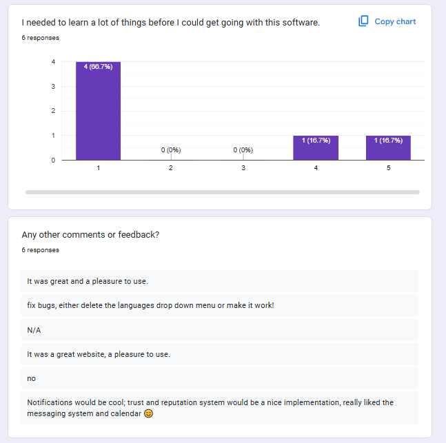
